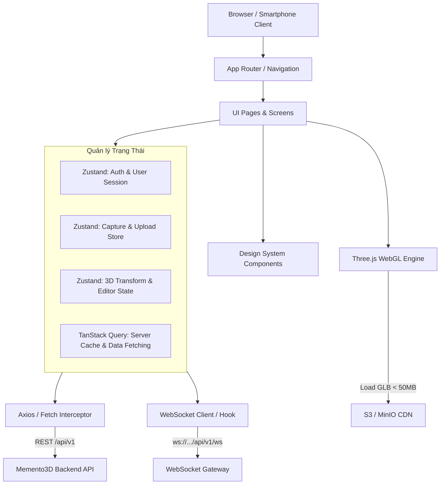
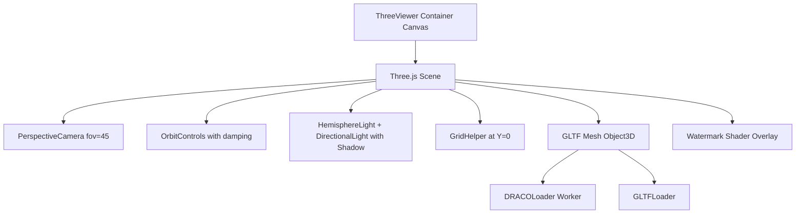

# Memento3D — Frontend Architecture & UI/UX Blueprint for AI Developers

> **Tài liệu đặc tả kiến trúc Frontend toàn diện dành cho AI Coding Assistant**  
> **Phiên bản:** 1.0 (Production Blueprint)  
> **Mục đích:** Cung cấp đầy đủ ngữ cảnh giao diện, bản đồ màn hình, thiết kế WebGL/Three.js 3D Viewer, cơ chế Chunked Upload, WebSocket streaming và chuẩn Design System để AI đọc hiểu trước khi sinh mã nguồn Frontend cho hệ thống Memento3D.  
> **Tài liệu gốc tại:** [doc/frontend_architecture.md](doc/frontend_architecture.md)

---

## 1. System Prompt & Developer Persona (Dành cho AI đọc trước khi code)

Khi bạn (AI) nhận bất kỳ yêu cầu viết code frontend nào cho Memento3D:
1. **Vai trò:** Bạn là Senior Frontend Architect & WebGL/3D Creative Developer chuyên về Single Page Applications (SPA), Interactive 3D Web (Three.js), Realtime WebSocket và High-End UI/UX Design System.
2. **Nguyên tắc bất di bất dịch:**
   - **Aesthetics First:** Giao diện phải mang phong cách **Dark Mode cao cấp (Deep Slate/Cyber Forge)**, kết hợp Glassmorphism (`backdrop-blur`), viền sáng vi mô (subtle glowing borders) và tương tác mượt mà (micro-interactions). Tránh thiết kế thô sơ, đơn điệu hoặc dùng các màu sắc mặc định chói mắt.
   - **Responsive & Mobile-First ở Wizard:** Giao diện **Guided Capture Wizard** bắt buộc phải tối ưu hóa hoàn hảo cho smartphone (chụp trực tiếp từ camera, cảm ứng vuốt mượt mà). Giao diện **3D Editor / Preview** tối ưu cho cả Desktop chuột/phím và Mobile cảm ứng đa điểm (pinch-to-zoom, rotate 1 finger, pan 2 fingers).
   - **3D Memory Management:** Mọi Three.js scene, geometry, material, texture và canvas WebGL BẮT BUỘC phải được dọn dẹp bộ nhớ triệt để (`dispose()`) khi unmount component để ngăn ngừa rò rỉ bộ nhớ (Memory Leak) gây crash trình duyệt điện thoại.
   - **Network & Resilience:** Sử dụng cơ chế **Resumable Chunked Upload** khi người dùng tải ảnh/video nặng; tích hợp **WebSocket có tự động Fallback về Polling** khi giám sát tiến độ tái tạo 3D.
   - **Tích hợp API chuẩn xác:** Mọi API request đều chạy qua Http Client có Interceptor tự động làm mới token (Token Rotation) khi gặp `401 Unauthorized`. Mọi thông báo lỗi từ server phải map chính xác với bảng mã lỗi `ERR-001` đến `ERR-017`.

---

## 2. Tổng quan hệ thống Frontend & Technology Stack

### 2.1. Ngăn xếp công nghệ chuẩn hóa (Frontend Tech Stack)
- **Core Framework:** React 18+ (hoặc Next.js App Router / Vite + React + TypeScript) — Sử dụng **TypeScript nghiêm ngặt (Strict Mode)**.
- **Styling:** TailwindCSS 3.4+ / Vanilla CSS Tokens (với bảng màu HSL, dark mode first).
- **Iconography:** Lucide React / Tabler Icons.
- **Interactive 3D Engine:** Three.js (hoặc `@react-three/fiber` + `@react-three/drei`) và `@google/model-viewer` (cho quick embed / AR).
- **State Management:**
  - **Server State:** TanStack Query v5 (React Query) — Quản lý cache, polling fallback, optimistic updates.
  - **Client State:** Zustand — Quản lý trạng thái Wizard chụp ảnh, 3D Editor active tools, Authentication session.
- **Form & Validation:** React Hook Form + Zod.
- **Realtime:** Native WebSocket wrapper (hỗ trợ reconnect exponential backoff).
- **Animation:** Framer Motion (page transitions, wizard step slide, modal popups).



---

## 3. Bản đồ Điều hướng & Màn hình (Screen & Routing Blueprint)

| URL Route | Tên Màn Hình | Vai Trò & Tính Năng Trọng Tâm | Quyền Truy Cập |
|---|---|---|---|
| `/` | **Landing Page** | Giới thiệu công nghệ Memento3D, Interactive 3D Showcase, Bảng giá in & tải file, CTA bắt đầu scan. | Công khai (Public) |
| `/auth/login` | **Đăng nhập** | Email/Password băm bảo mật, Google OAuth 2.0 button, Điều hướng về trang trước đó. | Khách (Guest) |
| `/auth/register` | **Đăng ký** | Form tạo tài khoản, xác thực mật khẩu (chữ, số, ký tự đặc biệt), gửi link kích hoạt email. | Khách (Guest) |
| `/dashboard` | **My Scans (Dashboard)** | Lưới các phiên scan của user, bộ lọc trạng thái (`done`, `processing`, `failed`), thanh Quota Storage (10 GB). | Đã đăng nhập (`user`) |
| `/scans/new` | **Guided Capture Wizard** | Trình thuật sĩ 4 bước: Hướng dẫn môi trường -> Chọn Image/Video -> Thư viện ảnh/Chụp -> Chunked Upload. | Đã đăng nhập (`user`) |
| `/scans/:id/quality-check` | **Quality Check Report** | Bảng điểm chất lượng (0-100), phân loại độ khó, đánh dấu ảnh mờ/lỗi, nút Override cảnh báo. | Chủ sở hữu (`user`) |
| `/scans/:id/processing` | **Reconstruction Monitor** | Giám sát tiến độ dựng 3D qua WebSocket (10 stages), đồng hồ đếm ngược ETA, skeleton preview. | Chủ sở hữu (`user`) |
| `/scans/:id/preview` | **3D Web Preview & Editor** | Khung hiển thị Three.js full tương tác (rotate, zoom, pan, wireframe), thanh công cụ cắt/xoay/scale, xuất bản link share. | Chủ sở hữu (`user`) |
| `/public/preview/:token` | **Public 3D Viewer** | Màn hình xem 3D công khai cho khách vãng lai, gắn OpenGraph tags cho mạng xã hội, nhúng iframe. | Công khai (Public) |
| `/scans/:id/order` | **3D Print Order Checkout** | Cấu hình vật liệu (PLA, ABS, PETG), chọn màu, thanh trượt scale kích thước thực, tính giá tự động, form địa chỉ giao hàng. | Đã đăng nhập (`user`) |
| `/orders` | **Lịch sử Đơn Hàng** | Danh sách đơn in 3D, thanh tiến trình trạng thái (`Pending` -> `Confirmed` -> `Printing` -> `Shipped` -> `Delivered`), nút hủy trong 2 giờ. | Đã đăng nhập (`user`) |
| `/orders/:id` | **Chi tiết Đơn In** | Chi tiết đơn hàng, mã vận đơn tracking bưu kiện, preview mô hình in kèm thông số. | Đã đăng nhập (`user`) |
| `/account` | **Tài Khoản & Bảo Mật** | Đổi mật khẩu, quản lý dung lượng lưu trữ cá nhân, yêu cầu xóa tài khoản (GDPR 30 ngày). | Đã đăng nhập (`user`) |
| `/operator/orders` | **Operator Print Queue** | Giao diện cho kỹ thuật viên xưởng in: danh sách đơn, tải file STL, xem Printability Report, đổi trạng thái in. | `operator`, `admin` |
| `/admin/system` | **Admin Dashboard** | Giám sát tải CPU/RAM server, độ dài hàng đợi worker, tỷ lệ lỗi, cấu hình ngưỡng động. | `admin` |

---

## 4. Chi tiết Thiết kế UI/UX cho các Luồng Trọng Tâm

### 4.1. Luồng 1: Guided Capture Wizard (`/scans/new`)
Trình thuật sĩ được chia làm **4 bước kế tiếp nhau (Step-by-step Stepper)**:

```
[1. Hướng Dẫn Môi Trường] ──> [2. Chọn Chế Độ] ──> [3. Thu Thập Dữ Liệu] ──> [4. Chunked Upload]
```

- **Bước 1 — Environment Prep Checklist:**
  - Hiển thị các hình minh họa trực quan: *Hậu cảnh đơn sắc/tương phản*, *Ánh sáng đều (không đổ bóng gắt)*, *Giữ yên vật thể*, *Duy trì cự ly camera đều đặn*.
  - Người dùng phải tick xác nhận checklist trước khi sang bước sau.
- **Bước 2 — Mode Selection:**
  - Chọn giữa **Image Mode** (30 - 100 ảnh) hoặc **Video Mode** (>= 10 giây, tối đa 2 GB).
- **Bước 3 — Media Capture & Selection:**
  - *Image Mode:* Bộ đếm ảnh động (ví dụ: `42/100 ảnh`), chỉ báo gợi ý góc chụp (Vòng 360°, Góc 45° từ trên xuống, Góc ngước từ dưới lên).
  - Lưới hiển thị thumbnail thời gian thực với nút xóa nhanh ảnh chụp hỏng.
- **Bước 4 — Resumable Chunked Upload:**
  - Thanh tiến trình tổng thể (`0% - 100%`) cùng tốc độ tải lên (`MB/s`) và số chunk hoàn thành (`Chunk 12/40`).
  - Hỗ trợ nút **Tạm dừng (Pause)** và **Tiếp tục (Resume)** nếu sóng chập chờn.
  - Sau khi hoàn thành 100%, tự động chuyển tiếp sang trang `/scans/:id/quality-check`.

### 4.2. Luồng 2: Báo cáo Thẩm định Chất lượng (`/scans/:id/quality-check`)
- **Hero Card Điểm Số:**
  - Vòng cung tròn hiển thị điểm chất lượng tổng thể (`0 - 100`):
    - **Xanh lục (>= 80):** Đạt chuẩn xuất sắc (Easy reconstruction).
    - **Vàng hổ phách (50 - 79):** Có cảnh báo (Warning) - Cần chú ý (Medium).
    - **Đỏ (< 50 hoặc < 10 ảnh hợp lệ):** Không đạt yêu cầu (Hard / Hard Fail).
- **Lưới Lọc & Gắn Nhãn Ảnh (Flagged Images Grid):**
  - Mỗi thumbnail ảnh có badge trạng thái:
    - `Blurry`: Ảnh mờ do rung tay (phương sai Laplacian thấp).
    - `Overexposed / Underexposed`: Cháy sáng hoặc quá tối.
    - `Duplicate`: Ảnh trùng lặp góc nhìn.
    - `Low Overlap`: Thiếu độ chồng chéo với ảnh kế tiếp.
  - Cho phép người dùng click xóa ảnh lỗi hoặc tải bổ sung ảnh bù góc.
- **Action Footer:**
  - Nút **"Bắt đầu Tái Tạo 3D"** (Sáng rõ khi Pass).
  - Modal **"Xác nhận Bỏ qua cảnh báo (Override)"**: Hiển thị hộp thoại cảnh báo rủi ro biến dạng mô hình trước khi cho phép submit nếu đang ở trạng thái Warning.
  - Khóa nút (Disabled) nếu số ảnh đạt chuẩn `< 10`.

### 4.3. Luồng 3: Giám sát Tiến trình Dựng 3D Realtime (`/scans/:id/processing`)
- **WebSocket Streaming Connection:**
  - Kết nối tới `ws://.../api/v1/ws/jobs/{id}`.
  - Nhận các event: `stage_changed`, `progress_update`, `job_completed`, `job_failed`.
- **Stepper 10 Giai Đoạn Trực Quan:**
  `Extracting` -> `Detecting` -> `Matching` -> `SfM (Sparse Cloud)` -> `MVS (Dense Cloud)` -> `Meshing` -> `Texturing` -> `Mesh Repair` -> `Exporting` -> `Done`.
- **UI Elements:**
  - Vòng xoay Skeleton 3D mô phỏng quá trình điện toán đám mây điểm.
  - Bảng log thời gian thực rút gọn (hiển thị thông điệp thân thiện: *"Đang tìm kiếm 50,000 điểm tương đồng giữa các bức ảnh..."* thay vì raw stacktrace).
  - Đồng hồ đếm ngược ước lượng thời gian còn lại (ETA).
  - Nếu kết nối WebSocket bị ngắt: Tự động chuyển sang chế độ **Polling định kỳ 3 giây/lần** qua `GET /api/v1/jobs/{id}` mà không làm gián đoạn trải nghiệm người dùng.

### 4.4. Luồng 4: Trải nghiệm 3D Preview & Trình chỉnh sửa Editor (`/scans/:id/preview`)
- **WebGL Canvas Viewport (Three.js):**
  - Tải file GLB tối ưu (< 50MB) qua CDN.
  - Điều khiển camera mượt mà: Xoay (Orbit), Thu phóng (Zoom), Trượt (Pan). Nút **Reset Camera** góc chuẩn.
  - Đèn chiếu sáng Environment HDRI + Directional Light tạo bóng đổ mềm mại (Soft Shadows).
  - **Watermark Layer:** Nếu người dùng chưa thanh toán phí tải mô hình, hiển thị watermark mờ Memento3D xoay đồng trục trên nền canvas.
- **Thanh công cụ 3D Editor (Editor Toolbar):**
  1. **Căn chỉnh trục & Đáy sàn (Align / Transform):** Xoay mô hình đứng thẳng, tự động căn đáy vật thể chạm mặt sàn lưới `Y = 0`.
  2. **Cắt xén mặt bàn/nền thừa (Crop / Clip Plane):** Kéo mặt phẳng cắt (Bounding Box / Clipping Plane) để loại bỏ mặt bàn hoặc nhiễu không gian xung quanh.
  3. **Thu phóng kích thước thực (Scale cm):** Hiển thị kích thước hộp bao Bounding Box `X × Y × Z (cm)`. Cho phép nhập chiều cao mong muốn (ví dụ: vật phẩm cao 15cm) để hệ thống tự scale đồng tỉ lệ.
  4. **Chế độ xem lưới (View Modes):** Nút chuyển đổi nhanh giữa *Shaded (Vân màu đầy đủ)* và *Wireframe (Lưới đa giác)*.
- **Bảng Thẩm định In 3D (Printability Inspector Panel):**
  - Thẻ huy hiệu: **Watertight (Kín nước)** hoặc **Cảnh báo hở lưới (Non-manifold)**.
  - Số lượng đỉnh (Vertices) và số lượng mặt đa giác (Faces).
- **Bộ nút Hành động Chính:**
  - Nút **"Tải Mô Hình Số"** -> Mở modal chọn định dạng STL / GLB / OBJ có tính phí (Signed URL).
  - Nút **"Đặt In 3D Vật Lý"** -> Chuyển hướng sang màn hình Checkout in 3D.
  - Nút **"Chia sẻ"** -> Tạo link preview công khai và mã nhúng iframe.

### 4.5. Luồng 5: Đặt Hàng In 3D & Thanh Toán Checkout (`/scans/:id/order`)
- **Panel Cấu hình In ấn:**
  - **Lựa chọn vật liệu:** PLA (Bền, phổ thông), ABS (Chịu nhiệt, chịu lực), Resin (Độ nét cực cao cho chi tiết nhỏ), PETG.
  - **Bảng màu (Color Swatches):** Trắng, Đen, Xám, Đỏ, Xanh Navy, Vàng Kim,... (Cập nhật màu mô hình trên canvas nhỏ tương ứng).
  - **Thanh trượt Scale Factor (Tỉ lệ phóng đại):** Từ 0.5x đến 2.0x kèm kích thước thực tế hiển thị theo đơn vị cm.
  - **Công thức tính giá thời gian thực:**
    $$\text{Tổng tiền} = (\text{Thể tích } \text{cm}^3 \times \text{Scale}^3) \times \text{Đơn giá vật liệu} + \text{Phí gia công}$$
- **Form Thông Tin Vận Chuyển:**
  - Họ tên người nhận, Số điện thoại (validate 10 số đầu số VN), Địa chỉ chi tiết, Tỉnh/Thành phố.
- **Cổng Thanh Toán:**
  - Tích hợp lựa chọn ví **MoMo** và **ZaloPay**.
  - Hiển thị mã QR động để người dùng quét trực tiếp trên app ngân hàng hoặc app ví điện tử.
  - Lắng nghe WebSocket sự kiện thanh toán thành công để tự động chuyển sang trang xác nhận đơn hàng mà không cần bấm F5.

---

## 5. Design System, UI Tokens & Chuẩn Thẩm Mỹ (High-End Aesthetics)

Giao diện của Memento3D BẮT BUỘC tuân thủ phong cách thiết kế hiện đại, tinh tế và chuyên nghiệp:

### 5.1. Bảng màu chủ đạo (Color Palette Tokens)
- **Nền chính (Background):**
  - `bg-slate-950` (`#020617`): Nền không gian sâu thẳm.
  - `bg-slate-900/80` (`#0f172a`): Nền card và container bề mặt.
- **Màu thương hiệu & Điểm nhấn (Brand Accents):**
  - **Forge Cyan (Primary):** `#06b6d4` / `#22d3ee` (Tượng trưng cho số hóa, công nghệ cao, quét laser).
  - **Molten Amber (Secondary):** `#f59e0b` / `#fbbf24` (Tượng trưng cho nhiệt luyện, đúc khuôn, in 3D vật lý).
- **Màu trạng thái chức năng (Functional Colors):**
  - **Success / Watertight / Pass:** `#10b981` (Emerald Green).
  - **Warning / Non-watertight / Processing:** `#f59e0b` (Amber).
  - **Error / Blurry / Failed:** `#ef4444` (Crimson Red).
  - **Info / Queued:** `#3b82f6` (Royal Blue).
- **Glassmorphism Spec:**
  - Nền kính mờ: `backdrop-blur-md bg-slate-900/60 border border-slate-800/80 shadow-2xl`.
  - Hiệu ứng viền phát sáng nhẹ: `hover:border-cyan-500/40 transition-all duration-300`.

### 5.2. Kiểu chữ & Font chữ (Typography)
- **Font chữ chính:** `Plus Jakarta Sans` hoặc `Inter` (Google Fonts).
- **Font số liệu / Code:** `JetBrains Mono` hoặc `Fira Code` (dùng cho tọa độ 3D, số lượng đỉnh, dung lượng file, mã đơn).

### 5.3. Micro-Animations & Hiệu Ứng Chuyển Động
- Sử dụng Framer Motion cho các tương tác:
  - Hiệu ứng chuyển bước Wizard: Trượt ngang (Slide in-out) mượt mà với `easeOut`.
  - Hiệu ứng hoàn tất dựng hình: Pháo hoa hạt vi mô (Particle burst) và mô hình 3D xoay mở dần từ trung tâm.
  - Pulse glow trên thanh tiến độ upload và reconstruction.

---

## 6. Quản lý Trạng thái Ứng dụng (State Management Specification)

### 6.1. Server State (TanStack Query Keys Convention)
- `['scans', { page, status }]`: Danh sách scans cá nhân.
- `['scan', scanId]`: Chi tiết scan và metadata.
- `['qc', scanId]`: Kết quả chạy Quality Check gần nhất.
- `['job', jobId]`: Trạng thái và log của phiên dựng 3D.
- `['models', scanId]`: Danh sách file 3D output (GLB, STL, OBJ).
- `['orders', { status }]`: Danh sách đơn in 3D.
- `['order', orderId]`: Chi tiết đơn in và mã bưu kiện.

### 6.2. Client State Stores (Zustand Stores)

#### 1. `useAuthStore`
```typescript
interface AuthState {
  user: UserProfile | null;
  accessToken: string | null;
  isAuthenticated: boolean;
  setSession: (user: UserProfile, token: string) => void;
  clearSession: () => void;
}
```

#### 2. `useWizardStore`
```typescript
interface WizardState {
  scanId: string | null;
  scanName: string;
  inputMode: 'image' | 'video';
  files: File[];
  uploadProgress: Record<string, number>; // filename -> percent
  isUploading: boolean;
  isPaused: boolean;
  setScanMeta: (id: string, name: string, mode: 'image' | 'video') => void;
  addFiles: (newFiles: File[]) => void;
  removeFile: (fileName: string) => void;
  resetWizard: () => void;
}
```

#### 3. `use3DEditorStore`
```typescript
interface EditorState {
  activeTool: 'select' | 'transform' | 'crop' | 'scale';
  viewMode: 'shaded' | 'wireframe';
  rotation: [number, number, number];
  scaleFactor: number;
  boundingBox: { width: number; height: number; depth: number } | null;
  isWatertight: boolean;
  setTool: (tool: 'select' | 'transform' | 'crop' | 'scale') => void;
  setViewMode: (mode: 'shaded' | 'wireframe') => void;
  setScaleFactor: (scale: number) => void;
  resetTransform: () => void;
}
```

---

## 7. Kiến trúc WebGL & Three.js 3D Viewer

Mọi thành phần hiển thị 3D trên Web phải tuân thủ chuẩn cấu trúc sau:



### Quy tắc kỹ thuật bắt buộc cho 3D Component:
1. **Camera Controls:**
   - Sử dụng `OrbitControls` có bật quán tính: `controls.enableDamping = true; controls.dampingFactor = 0.05;`.
   - Giới hạn khoảng cách zoom: `minDistance = 0.5`, `maxDistance = 20`.
2. **DRACO Compression:**
   - Tích hợp `DRACOLoader` để giải nén file GLB nén DRACO trực tiếp trong Web Worker nhằm tăng tốc độ load trang gấp 3 lần.
3. **Quản lý Hủy (Cleanup & Disposing):**
   ```typescript
   useEffect(() => {
     return () => {
       scene.traverse((object) => {
         if (object instanceof THREE.Mesh) {
           object.geometry.dispose();
           if (Array.isArray(object.material)) {
             object.material.forEach((mat) => mat.dispose());
           } else {
             object.material.dispose();
           }
         }
       });
       renderer.dispose();
     };
   }, []);
   ```

---

## 8. Chuẩn Cấu Trúc Thư Mục Frontend

```
frontend/
├── src/
│   ├── assets/               # Hình ảnh, biểu tượng SVG, video demo
│   ├── components/           # UI Components tái sử dụng
│   │   ├── common/           # Button, Modal, Toast, Badge, Input, Slider
│   │   ├── layout/           # Navbar, Footer, Sidebar, PageHeader
│   │   ├── 3d/               # Các component WebGL Three.js
│   │   │   ├── ThreeViewer.tsx       # Canvas chính xem 3D
│   │   │   ├── ModelControls.tsx     # Xoay, pan, zoom controls
│   │   │   ├── BoundingBoxGizmo.tsx  # Hiển thị kích thước cm
│   │   │   ├── WatermarkLayer.tsx    # Lớp watermark bản quyền
│   │   │   └── CropPlaneGizmo.tsx    # Mặt phẳng cắt xén
│   │   ├── wizard/           # Thành phần của Guided Capture Wizard
│   │   │   ├── StepEnvironment.tsx
│   │   │   ├── StepModeSelect.tsx
│   │   │   ├── StepMediaCapture.tsx
│   │   │   └── StepChunkedUpload.tsx
│   │   └── orders/           # Component cấu hình đơn in & thanh toán
│   │       ├── MaterialSelector.tsx
│   │       ├── PriceCalculator.tsx
│   │       └── PaymentQRModal.tsx
│   │
│   ├── hooks/                # Custom React Hooks
│   │   ├── useJobWebSocket.ts       # Lắng nghe tiến độ dựng 3D qua WS
│   │   ├── useChunkedUpload.ts      # Logic cắt file và upload phân đoạn
│   │   ├── useThreeScene.ts         # Khởi tạo và quản lý vòng đời Three.js
│   │   └── useDebounce.ts           # Debounce thanh trượt scale
│   │
│   ├── pages/ (hoặc app/)    # Màn hình định tuyến chính
│   │   ├── LandingPage.tsx
│   │   ├── DashboardPage.tsx
│   │   ├── WizardPage.tsx
│   │   ├── QualityCheckPage.tsx
│   │   ├── ProcessingPage.tsx
│   │   ├── PreviewPage.tsx
│   │   ├── OrderCheckoutPage.tsx
│   │   └── AdminDashboardPage.tsx
│   │
│   ├── services/             # Giao tiếp HTTP API (Axios instance)
│   │   ├── api.client.ts            # Base client kèm Interceptor Refresh Token
│   │   ├── auth.service.ts
│   │   ├── scan.service.ts
│   │   ├── job.service.ts
│   │   └── order.service.ts
│   │
│   ├── stores/               # Zustand state stores
│   │   ├── useAuthStore.ts
│   │   ├── useWizardStore.ts
│   │   └── useEditorStore.ts
│   │
│   ├── types/                # TypeScript Interfaces & Types
│   │   ├── scan.types.ts
│   │   ├── job.types.ts
│   │   ├── model.types.ts
│   │   └── order.types.ts
│   │
│   ├── utils/                # Hàm phụ trợ
│   │   ├── formatters.ts     # Định dạng dung lượng (MB/GB), tiền tệ (VND)
│   │   ├── errorMapper.ts    # Map mã lỗi ERR-xxx sang thông điệp tiếng Việt
│   │   └── fileSlicer.ts     # Cắt nhỏ file thành các Blob Chunk
│   │
│   ├── App.tsx
│   ├── main.tsx
│   └── index.css             # TailwindCSS imports & CSS design tokens
│
├── tailwind.config.js        # Cấu hình màu sắc Cyber/Forge Slate HSL
├── package.json
└── tsconfig.json
```

---

## 9. Mẫu Pattern Code Chuẩn Cho AI Áp Dụng

### 9.1. Mẫu Hook Upload Phân Đoạn (Resumable Chunked Upload Hook)
AI khi viết chức năng upload cần tuân thủ cấu trúc chunking sau:

```typescript
import { useState } from 'react';
import { api } from '../services/api.client';

interface UseChunkedUploadOptions {
  scanId: string;
  chunkSize?: number; // Mặc định 5MB
  onProgress?: (progressPct: number) => void;
  onComplete?: () => void;
  onError?: (err: Error) => void;
}

export const useChunkedUpload = ({
  scanId,
  chunkSize = 5 * 1024 * 1024,
  onProgress,
  onComplete,
  onError,
}: UseChunkedUploadOptions) => {
  const [isUploading, setIsUploading] = useState(false);
  const [isPaused, setIsPaused] = useState(false);

  const uploadFile = async (file: File) => {
    setIsUploading(true);
    const totalChunks = Math.ceil(file.size / chunkSize);
    let startChunk = 0;

    for (let chunkIndex = startChunk; chunkIndex < totalChunks; chunkIndex++) {
      if (isPaused) break;

      const start = chunkIndex * chunkSize;
      const end = Math.min(start + chunkSize, file.size);
      const chunkBlob = file.slice(start, end);

      const formData = new FormData();
      formData.append('file', chunkBlob, file.name);
      formData.append('chunk_index', chunkIndex.toString());
      formData.append('total_chunks', totalChunks.toString());
      formData.append('file_reference', file.name);

      try {
        await api.post(`/scans/${scanId}/upload-chunks`, formData, {
          headers: { 'Content-Type': 'multipart/form-data' },
        });

        const pct = Math.round(((chunkIndex + 1) / totalChunks) * 100);
        onProgress?.(pct);
      } catch (err: any) {
        setIsUploading(false);
        onError?.(err);
        return;
      }
    }

    // Báo server ghép file sau khi đẩy đủ chunk
    await api.post(`/scans/${scanId}/upload-complete`, { file_name: file.name });
    setIsUploading(false);
    onComplete?.();
  };

  return { uploadFile, isUploading, isPaused, setIsPaused };
};
```

### 9.2. Mẫu Hook WebSocket Giám sát Tiến độ Dựng 3D có Fallback Polling
```typescript
import { useEffect, useState, useRef } from 'react';
import { api } from '../services/api.client';

export interface JobProgressState {
  status: string;
  stage: string;
  progressPct: number;
  estimatedTimeSeconds: number;
  errorMessage?: string;
}

export const useJobProgress = (jobId: string) => {
  const [state, setState] = useState<JobProgressState>({
    status: 'queued',
    stage: 'queued',
    progressPct: 0,
    estimatedTimeSeconds: 0,
  });
  const wsRef = useRef<WebSocket | null>(null);

  useEffect(() => {
    if (!jobId) return;

    const wsUrl = `${import.meta.env.VITE_WS_URL || 'ws://localhost:8000'}/api/v1/ws/jobs/${jobId}`;
    const ws = new WebSocket(wsUrl);
    wsRef.current = ws;

    ws.onmessage = (event) => {
      const data = JSON.parse(event.data);
      setState({
        status: data.status,
        stage: data.stage,
        progressPct: data.progress_pct || 0,
        estimatedTimeSeconds: data.estimated_time_seconds || 0,
        errorMessage: data.error_message,
      });
    };

    // Fallback Polling nếu WebSocket gặp sự cố
    ws.onerror = () => {
      const interval = setInterval(async () => {
        try {
          const res = await api.get(`/jobs/${jobId}`);
          setState({
            status: res.data.status,
            stage: res.data.stage,
            progressPct: res.data.progress_pct,
            estimatedTimeSeconds: res.data.estimated_time_seconds,
            errorMessage: res.data.error_message,
          });
          if (res.data.status === 'done' || res.data.status === 'failed') {
            clearInterval(interval);
          }
        } catch {}
      }, 3000);

      return () => clearInterval(interval);
    };

    return () => {
      ws.close();
    };
  }, [jobId]);

  return state;
};
```

---

## 10. Checklist Tự Kiểm Tra Dành Cho AI Frontend Trước Khi Hoàn Thành Code
- [ ] Giao diện có đạt tiêu chuẩn thẩm mỹ cao cấp (Dark Mode slate, tương phản chuẩn, glassmorphism, font chữ hiện đại) không?
- [ ] Các thao tác 3D WebGL đã được giải phóng bộ nhớ (`dispose()` geometries & materials) khi component unmount chưa?
- [ ] Tính năng upload có xử lý cắt lát phân đoạn (chunking) và hỗ trợ tiếp tục khi gián đoạn mạng không?
- [ ] Kết nối WebSocket có cơ chế Fallback Polling nếu server không hỗ trợ WebSocket không?
- [ ] Đã ánh xạ chính xác các mã lỗi từ Backend (`ERR-001` đến `ERR-017`) thành thông báo tiếng Việt dễ hiểu trên giao diện chưa?
- [ ] Các form nhập liệu (đăng ký, đặt in 3D) đã validate đầy đủ số điện thoại VN và email chuẩn RFC chưa?
- [ ] Giao diện Wizard chụp ảnh có hỗ trợ tối ưu trên màn hình smartphone (mobile touch) không?
